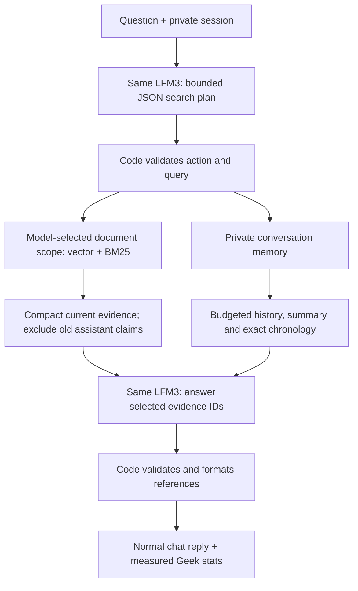

# Draft notes for a future blog post

This is engineering material, not a published website article. Generated evaluation
answers are not authoritative facts about Tom. Check source claims before quoting.

Working title: **Making a small CPU-only RAG chatbot faster without hiding failures**.

1. Start with the host: two vCPUs, 8 GB RAM, LFM3-1.7B Q4_K_M, pinned llama.cpp,
   MiniLM embeddings and Qdrant/BM25 retrieval. A roughly 1 GB weight file does not
   describe total runtime memory.
2. Measure where time goes. One production sample spent 27.8 s processing prompts,
   9.2 s generating tokens and only 20 ms retrieving. Retrieval caching was not
   the main opportunity.
3. Show a rejected optimization: fewer passages/shorter instructions made some
   replies faster but confused writing about Cursor with building Cursor. HTTP or
   successful agent completion was not a sufficient quality check.
4. Separate model decisions from deterministic mechanics. A compact structured
   plan chooses a retrieval scope and query; code validates, filters metadata,
   retrieves and bounds context. Earlier assistant claims cannot become fresh
   website evidence. Conversation history remains private and searchable.
5. Explain memory costs. Every-two-turn compression adds model calls; an actual
   rendered-token threshold avoids unnecessary work. Returning visible-history
   metadata avoids reinserting duplicate messages through the memory tool.
6. Explain cache honesty. Enabled caching does not mean every request is a hit.
   Display runtime-reported cached tokens and a weighted ratio, plus explicit zero
   or unavailable. Bound the optional RAM cache separately from the whole model.
7. Explain output contracts. Request a bounded answer plus explicit model-selected
   evidence IDs. Code formats only those selections, rather than asking a small
   model to reliably format inline citations or inventing references from every
   retrieval match. Valid IDs still do not prove semantic claim support.
8. Report the final observed sequence: 245.827 → 142.966 seconds overall, median
   39.481 → 21.461; 5/6 → 6/6 agent completions. The old article reply was a fast
   false abstention; the new one took longer and actually summarized the article.
   Do not describe this as a statistical latency SLA or perfect factual accuracy.
9. Close with limitations: technical answers can include unrelated writing;
   article summaries may omit important safeguards; structured final answers are
   buffered, so no early-token benefit was observed. Larger quality evaluation is
   still needed before broad claims about the model.

Use the comparison, raw public-site test conversations, content review, scripts and
runtime manifest in `eval-results/optimization-2026-11-26/`. The longer experiment
journal is `OPTIMIZATION_LOG.md`; operating commands are in
`OPTIMIZATION_OPERATIONS.md`. No real visitor conversations or credentials are
included. The development subagent is distinct from the website runtime: a smaller
coding agent implemented changes while the orchestrator designed/reviewed tests
and handled deployment; the website still runs the one LiquidAI model.
